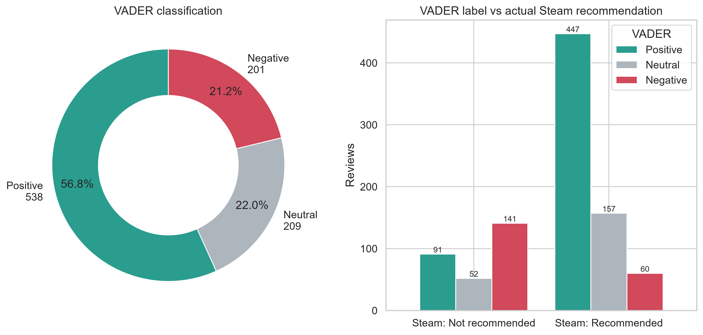
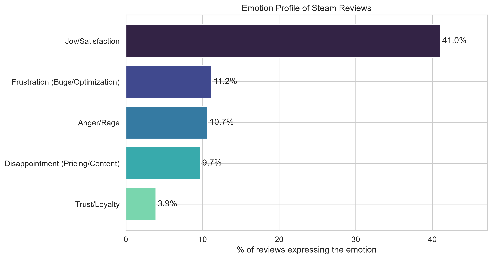
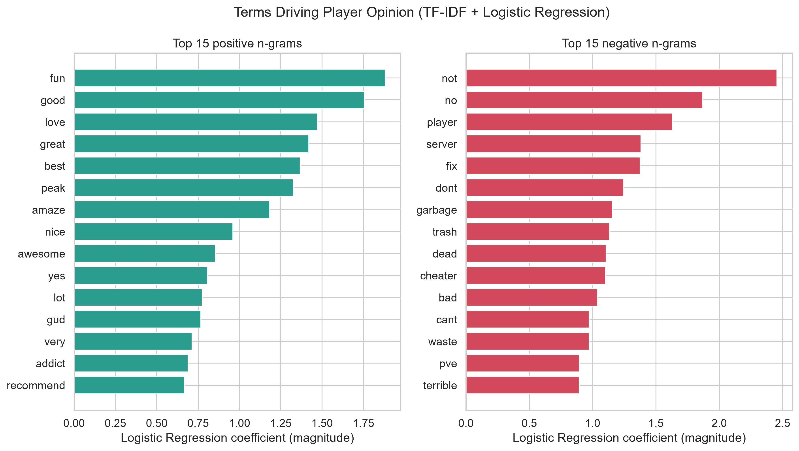
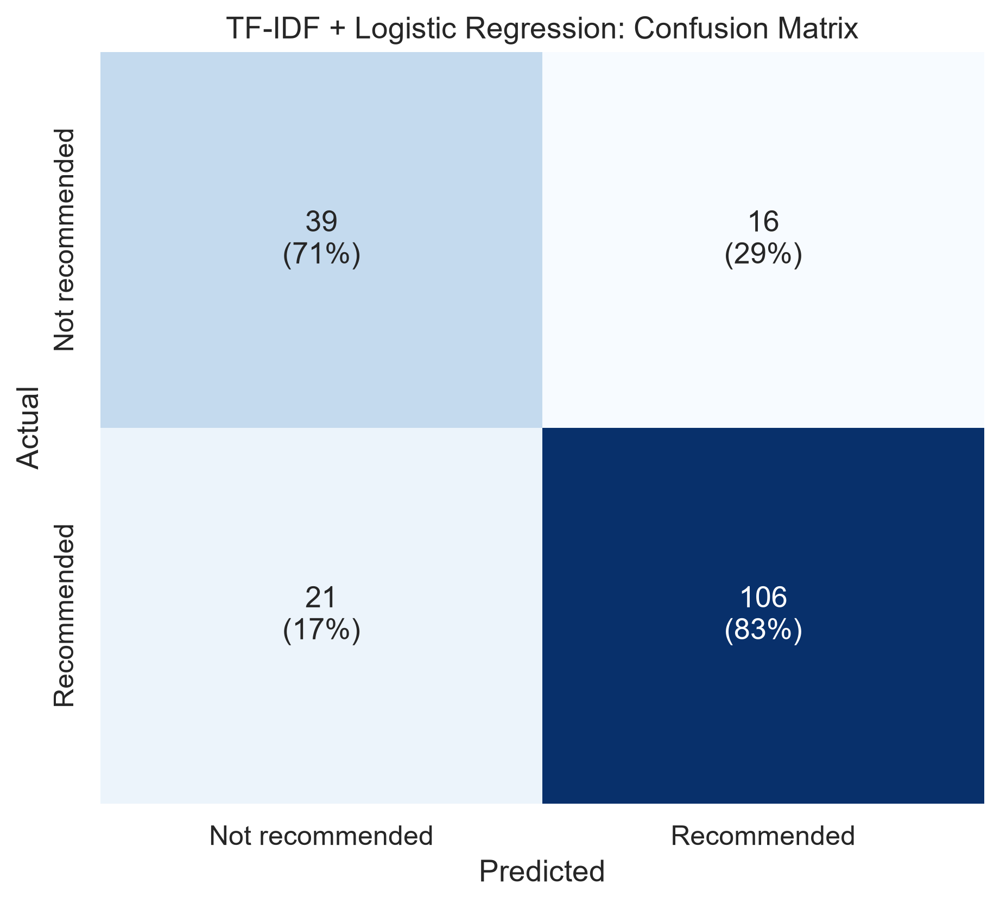

# CodeAlpha_SentimentAnalysis

Sentiment and emotion analysis of Steam user reviews for the **CodeAlpha Data Analytics Internship (Task 4)**. It uses the review dataset scraped in Task 1 and classifies opinion as Positive, Negative or Neutral. It also detects five gaming-specific emotions and turns the results into product and marketing insights.

## NLP Preprocessing Pipeline
1. **Markup removal:** URLs, HTML tags/entities and Steam BBCode (`[h1]`, `[b]`, `[url=...]`).
2. **Normalization:** lowercase, contraction expansion (`can't` -> `can not`), special-character removal.
3. **Tokenization:** NLTK `RegexpTokenizer`.
4. **Stopword removal:** NLTK English stopwords, **keeping negations and intensifiers** (`not`, `no`, `never`, `very`, `too`) plus the domain words `game`/`steam` removed.
5. **Lemmatization:** NLTK `WordNetLemmatizer` (noun then verb pass).
6. VADER runs on the markup-cleaned original text, since it relies on capitalization and punctuation. The emotion lexicon runs on the normalized text, and the ML model runs on the lemmatized text.

## Methods
| Layer | Technique |
|---|---|
| Polarity | VADER compound score: >= 0.05 Positive, <= -0.05 Negative, otherwise Neutral |
| Emotions | Domain-aware regex lexicon for Joy/Satisfaction, Anger/Rage, Frustration (Bugs/Optimization), Trust/Loyalty, Disappointment (Pricing/Content), with simple negation handling |
| Supervised ML | `TfidfVectorizer(ngram_range=(1,2), max_features=3000)` + `LogisticRegression` predicting Steam's recommended label (80/20 stratified split) |
| Anomaly detection | High-Playtime Dissatisfaction: top-quartile playtime and not recommended |

## Lexicon vs ML Accuracy
Run the pipeline, then paste the table from `reports/sentiment_report.md` here.

| Model | Accuracy | Macro-F1 |
|---|---|---|
| VADER (lexicon) | see report | see report |
| TF-IDF + Logistic Regression | see report | see report |

Lexicon methods need no training data and are interpretable, but they struggle with gaming slang, sarcasm and mixed reviews. A supervised model learns domain vocabulary from the labels, at the cost of depending on label quality.

## Emotion Detection Insights
Paste the emotion-prevalence table and top n-grams from `reports/sentiment_report.md` here, with a short comment on which emotions separate recommended from not-recommended reviews.

## Actionable Recommendations
*Confirm each one against the numbers in your report before publishing.*
1. **Prioritize stability patches (Product):** if Frustration (Bugs/Optimization) dominates negative reviews, schedule performance and crash fixes first and publish a patch roadmap. Technical complaints are the most fixable source of negative sentiment.
2. **Protect your long-term players (Product/Community):** review the High-Playtime Dissatisfaction list in `data/sentiment_enriched_reviews.csv`. Players with many hours who still leave a negative review are usually reacting to a specific change or a content gap, so target them with feedback surveys and end-game content.
3. **Adjust pricing and positioning (Marketing):** where Disappointment (Pricing/Content) is common, test discounts or bundles and set expectations in store-page copy. Where Trust/Loyalty and Joy are high, use player-voice phrases from the top positive n-grams in marketing.

## Visualizations





## Setup and Usage
```bash
git clone https://github.com/md-tanjimul-islam/CodeAlpha_SentimentAnalysis.git
cd CodeAlpha_SentimentAnalysis
python -m venv .venv && source .venv/bin/activate   # Windows: .venv\Scripts\activate
pip install -r requirements.txt
# place steam_user_reviews.csv in data/
python src/sentiment_analysis.py    # NLTK data downloads automatically on first run
```

Outputs: `data/sentiment_enriched_reviews.csv`, `plots/*.png`, `reports/sentiment_report.md`.

## Limitations
- The emotion lexicon is hand-built and keyword-based, so it can miss sarcasm and unusual phrasing.
- The Steam recommend flag is the ML label. It is noisy because reviewers sometimes recommend a game while criticizing it.
- If the data came from the synthetic fallback in Task 1, the results describe simulated text, not real players.